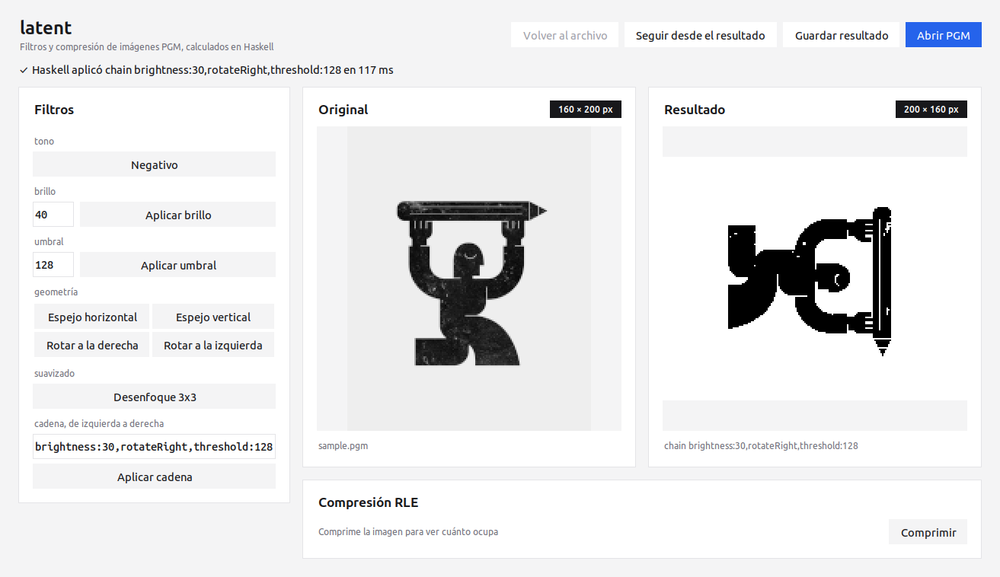
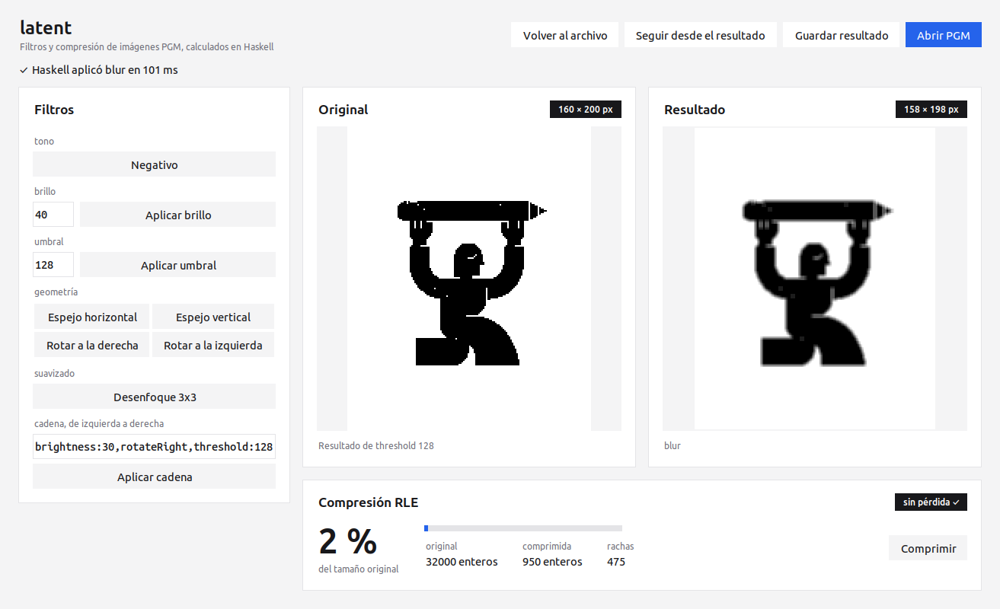
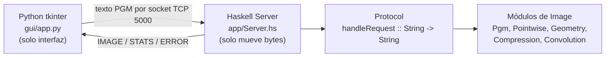
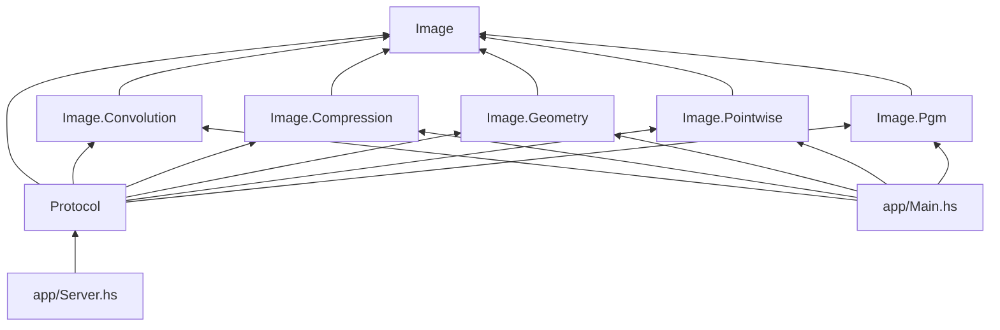

# latent: Filtro y Compresor Funcional de Imágenes Matriciales

Proyecto final de Programación funcional (UTM, Ingeniería en Computación).
Autor: Jesús Alfonso Morales Jaimes, grupo 702-B.

El programa lee imágenes en escala de grises en formato PGM P2 (texto ASCII),
les aplica filtros (negativo, brillo, umbral, espejos, rotaciones, desenfoque
y cadenas de filtros) y las comprime con RLE (run-length encoding). Todo el
procesamiento está escrito en Haskell como funciones puras sobre listas de
listas `[[Int]]`. Una interfaz en Python con tkinter solo elige el archivo,
manda el texto al servidor Haskell por un socket TCP y muestra la respuesta.

## Cómo correrlo

Requisitos: GHC 9.10 con los paquetes `network`, `bytestring` y `directory`,
y `python3-tk`. No necesita internet.

```bash
./run.sh                         # compila el servidor, lo arranca y abre la GUI
runghc -isrc test/Tests.hs       # pruebas (deben salir todas OK)
runghc -isrc app/Main.hs         # demo por consola: genera imágenes en output/
```

## Capturas




## Ecosistema



## Grafo de dependencias entre módulos



## Protocolo

Petición: primera línea = comando, el resto = el PGM P2 completo.

| Comando | Respuesta |
|---|---|
| `negative`, `mirrorHorizontal`, `mirrorVertical`, `rotateRight`, `rotateLeft`, `blur`, `identity` | `IMAGE` y el PGM resultante |
| `brightness <n>`, `threshold <n>`, `intensity <n>` | `IMAGE` y el PGM resultante |
| `chain brightness:30,rotateRight,threshold:128` | `IMAGE` con los filtros aplicados en orden |
| `compress` | `STATS` con `originalSize`, `compressedSize`, `runs`, `percent`, `roundTrip` |
| cualquier error | `ERROR <mensaje>` |

## Estructura

- `src/`: núcleo puro (sin IO). `Image`, `Image.Pgm`, `Image.Pointwise`,
  `Image.Geometry`, `Image.Compression`, `Image.Convolution`, `Protocol`.
- `app/`: lo único con IO. `Server.hs` (sockets) y `Main.hs` (demo por consola).
- `gui/app.py`: interfaz tkinter, sin lógica de píxeles.
- `test/Tests.hs`: pruebas.
- `docs/`: explicación del código, trabajo futuro, guion del demo, ADRs y hoja de entrega.

## Uso de IA

Se usó Claude Code (extensión de VS Code) con el modelo Claude Opus 5.5 de
Anthropic como compañero de desarrollo. Las funciones base (`onRows`, `width`,
`height`, `parsePgm`, `renderPgm`, `readPgm`, `writePgm` y las primeras pruebas)
las escribió el autor; ver `docs/explicacion.md`.
